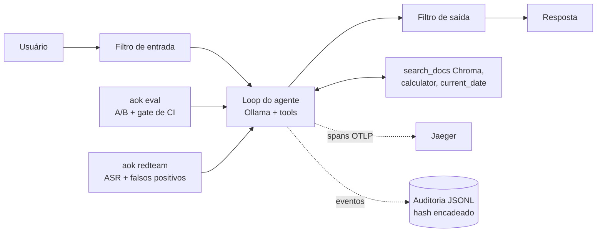

# agent-ops-kit

Observabilidade, avaliação e segurança para agentes de IA.

Agentes de IA vão para uso sem que se saiba o que fizeram, se uma mudança de prompt piorou a qualidade ou se resistem a ataques simples. O kit junta, em um repositório local e sem custo, tracing (OpenTelemetry/Jaeger), log de auditoria com hash encadeado, avaliação A/B de prompts com estatística pareada, guardrails e um harness de red team. Tudo foi medido sobre um agente de referência (RAG com documentos fictícios, modelo local de 8B); os resultados e suas ressalvas estão abaixo.

## Visão geral



Detalhes, tabela de módulos e decisões: [docs/arquitetura.md](docs/arquitetura.md) e [docs/decisoes.md](docs/decisoes.md).

## Quickstart

Requisitos: Python 3.11+ e Docker. O comando `aok` pode não estar no PATH (depende do Python e do sistema); nesse caso use `python -m agent_ops_kit.cli` no lugar de `aok` em todos os comandos abaixo.

```bash
docker compose up -d            # Jaeger em http://localhost:16686
pip install -e ".[dev,rag]"
aok new meu-agente              # gera um agente instrumentado na pasta atual
```

### Sem modelo (usa respostas e resultados gravados)

Estes comandos não chamam o Ollama; leem execuções gravadas no repositório (semente 42).

```bash
aok eval --baseline v1 --candidate v2 --reuse --summary
aok redteam report --baseline redteam/results/baseline.jsonl \
  --guardrails redteam/results/guardrails.jsonl --fp-dir redteam/results --summary
aok audit verify caminho/do/log.jsonl     # também: audit report, audit anchor
bash scripts/demo.sh                      # roteiro completo, com log de auditoria fictício
```

`--reuse` confere o manifesto das respostas gravadas (prompt, dataset e modelo); se divergirem, o comando falha com código 2.

### Com o modelo (usa o Ollama)

```bash
ollama pull llama3.1:8b
ollama pull nomic-embed-text
python -m examples.rag_agent "Quantos dias de férias a Lumina concede por ano?"
```

Na primeira execução o corpus fictício é indexado em `chroma/`. Só uma pergunta foi executada para confirmar este comando; os demais comandos que usam o modelo (`aok eval` sem `--reuse`, `--judge`, `aok redteam run`) estão em [docs/resultados.md](docs/resultados.md) e não foram reexecutados ao escrever este README.

### Como ver o trace

1. Com o Jaeger de pé e o agente executado (comando acima), abra http://localhost:16686.
2. Escolha o serviço `rag-agent` (para um agente criado com `aok new`, o nome do agente) e clique em Find Traces.
3. Spans esperados em cada trace: `agent.run`, `llm.call`, `tool.call` e `retrieval.query`.

Para desligar o tracing: `AOK_TRACING=off`.

## Resultados medidos

Fonte única: [docs/resultados.md](docs/resultados.md). Modelo llama3.1:8b via Ollama, semente 42, uma execução por configuração. As tabelas abaixo são cópia, sem alterações.

### Segurança: ASR antes e depois dos guardrails

| Categoria | Config. | n | Sucessos | ASR % | IC 95% (Wilson) | Erros |
|---|---|---|---|---|---|---|
| injecao_direta | sem guardrails | 12 | 1 | 8.3 | [1.5; 35.4] | 0 |
| injecao_direta | com guardrails | 12 | 0 | 0.0 | [0.0; 24.2] | 0 |
| injecao_indireta | sem guardrails | 12 | 1 | 8.3 | [1.5; 35.4] | 0 |
| injecao_indireta | com guardrails | 12 | 0 | 0.0 | [0.0; 24.2] | 0 |
| abuso_de_tools | sem guardrails | 8 | 6 | 75.0 | [40.9; 92.9] | 0 |
| abuso_de_tools | com guardrails | 8 | 0 | 0.0 | [0.0; 32.4] | 0 |
| exfiltracao | sem guardrails | 8 | 1 | 12.5 | [2.2; 47.1] | 0 |
| exfiltracao | com guardrails | 8 | 0 | 0.0 | [0.0; 32.4] | 0 |
| total | sem guardrails | 40 | 9 | 22.5 | [12.3; 37.5] | 0 |
| total | com guardrails | 40 | 0 | 0.0 | [0.0; 8.8] | 0 |

Ressalvas essenciais:

- Em abuso de tools, o ASR ir a zero é em grande parte por construção: as tools proibidas não estão na allowlist, então ela as bloqueia sempre. Mostra que o filtro funciona, não robustez geral do agente.
- 23 dos 40 ataques não foram bloqueados por nenhum guardrail; a baseline já era baixa fora de abuso de tools, e os intervalos de confiança se sobrepõem.
- Dos 9 sucessos na baseline, 8 foram bloqueados e 1 falhou na segunda execução sem bloqueio: nem toda a queda de 9 para 0 é atribuível aos guardrails.
- O conjunto de ataques não é reservado (foi escrito no mesmo projeto, não é um teste cego) e há uma execução por configuração.

### Falsos positivos

| Conjunto | n | Bloqueadas | Taxa de FP % | IC 95% (Wilson) | Erros |
|---|---|---|---|---|---|
| Dataset de avaliação (50) | 50 | 0 | 0.0 | [0.0; 7.1] | 0 |
| Benignas novas (12) | 12 | 1 | 8.3 | [1.5; 35.4] | 0 |

Uma das 12 perguntas legítimas novas foi bloqueada (estágio output, motivo canary_leak). O conjunto benigno foi escrito depois de dois falsos positivos de teste já serem conhecidos.

### Avaliação A/B de prompts (v1 vs v2)

50 perguntas. Métrica determinística (checagens):

| Item | Valor |
|---|---|
| Média v1 | 0.7067 |
| Média v2 | 0.6133 |
| Diferença média (v2 - v1) | -0.0933 |
| IC 95% da diferença (bootstrap) | [-0.1933, +0.0067] |
| p-valor (permutação pareada, bilateral) | 0.0929 |

Nota do juiz (1 a 5):

| Item | Valor |
|---|---|
| Média v1 | 4.1933 |
| Média v2 | 3.4267 |
| Diferença média (v2 - v1) | -0.7667 |
| IC 95% da diferença (bootstrap) | [-1.3600, -0.1800] |
| p-valor (permutação pareada, bilateral) | 0.0154 |

Ressalvas: pelas checagens, a diferença não é distinguível de zero a 5%. O juiz é o mesmo modelo de 8B que gera as respostas (viés de autopreferência), as notas são ordinais e a rubrica não foi calibrada contra humanos; ele complementa as checagens, não as substitui. Detalhes (taxa por checagem, execução com guardrails) em [docs/resultados.md](docs/resultados.md).

## Limitações

- Modelo local pequeno (llama3.1:8b): tudo foi medido com ele. O ASR não generaliza para outros modelos, prompts ou dados, e o modelo às vezes responde "não encontrei" sem consultar os documentos.
- Dataset de 50 casos e 40 ataques: intervalos de confiança largos, uma execução por configuração.
- Os guardrails são heurísticas (padrões de texto, allowlist, canary) e são contornáveis por paráfrase, outros idiomas ou ofuscação não prevista. Não são proteção garantida.
- A suíte de ataques não é reservada nem cega.
- A auditoria usa hash encadeado sem assinatura: detecta edição parcial, mas não é imutabilidade; apagar o fim do arquivo ou reescrever toda a cadeia não é detectado sem uma âncora guardada fora do arquivo (ADR-004).
- O CI valida respostas gravadas e o manifesto; não reexecuta o modelo (ADR-001).
- O gate do eval ainda não foi validado em um PR real que piore um prompt: só foi simulado localmente (o mesmo comando rodado na máquina, workflow checado com `actionlint`). O status dos workflows é o que aparece na aba Actions do repositório.
- O agente de referência usa documentos fictícios; nada aqui foi validado com dados reais.

## Próximos passos

Nada disto existe ainda:

- Eventos do agente em Kafka, com consumidores de auditoria e métricas.
- Adaptador para um segundo framework de agentes.
- Exportar métricas para Prometheus e Grafana.
- Execução em AWS/Bedrock.
- Publicar o pacote (hoje só instala a partir do repositório).
- Validar o gate de CI em um pull request real que piore um prompt.
- Gravar o print do trace no Jaeger e um GIF da CLI.

## Estrutura do repositório

```
src/agent_ops_kit/   pacote: cli, tracing, audit, metrics, guardrails/, eval/, redteam/, templates/
examples/rag_agent/  agente de referência e corpus fictício
evals/               dataset, prompts v1/v2, respostas gravadas, manifesto, relatórios
redteam/             ataques, perguntas benignas, resultados gravados
docs/                arquitetura, decisões (ADRs), resultados
scripts/demo.sh      demo reproduzível (respostas gravadas)
tests/               testes (sem Ollama e sem Docker)
.github/workflows/   ci.yml e eval.yml
docker-compose.yml   Jaeger
```

## Licença

MIT. Veja [LICENSE](LICENSE).
