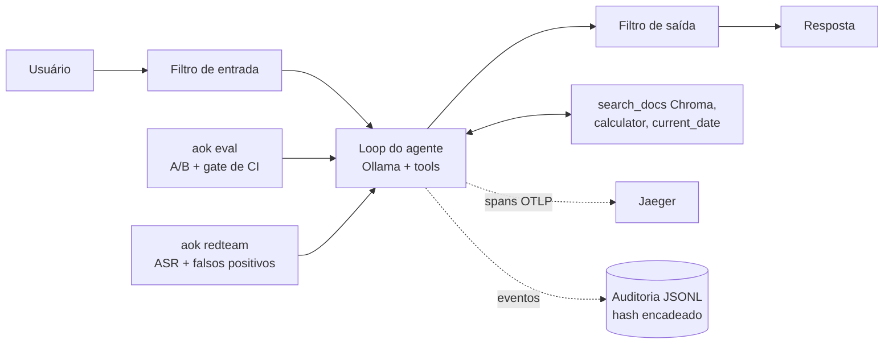

# agent-ops-kit

Observabilidade, avaliação e segurança para agentes de IA.

Agentes de IA vão para uso sem que se saiba o que fizeram, se uma mudança de prompt piorou a qualidade ou se resistem a ataques simples. O kit junta, em um repositório local e sem custo, tracing (OpenTelemetry/Jaeger), log de auditoria com hash encadeado, avaliação A/B de prompts com estatística pareada, guardrails e um harness de red team. Tudo foi medido sobre um agente de referência (RAG com documentos fictícios, modelo local de 8B); os resultados e suas ressalvas estão abaixo.

## Visão geral



Detalhes, tabela de módulos e decisões: [docs/arquitetura.md](docs/arquitetura.md) e [docs/decisoes.md](docs/decisoes.md).

## Quickstart

Requisitos: Python 3.11+ e Docker. O comando `aok` pode não estar no PATH (depende do Python e do sistema); nesse caso use `python -m agent_ops_kit.cli` no lugar de `aok` em todos os comandos abaixo.

```bash
docker compose up -d            # Jaeger em http://localhost:16686
pip install -e ".[dev,rag]"
aok new meu-agente              # gera um agente instrumentado na pasta atual
```

### Sem modelo (usa respostas e resultados gravados)

Estes comandos não chamam o Ollama; leem execuções gravadas no repositório (semente 42).

```bash
aok eval --baseline v1 --candidate v2 --reuse --summary
aok redteam report --baseline redteam/results/baseline.jsonl \
  --guardrails redteam/results/guardrails.jsonl --fp-dir redteam/results --summary
aok audit verify caminho/do/log.jsonl     # também: audit report, audit anchor
bash scripts/demo.sh                      # roteiro completo, com log de auditoria fictício
```

`--reuse` confere o manifesto das respostas gravadas (prompt, dataset e modelo); se divergirem, o comando falha com código 2.

### Relatório para quem não é técnico

```bash
aok report build --out reports/pacote
aok check --publish reports/publicados --agent-id meu-agente   # opcional: --audit LOG, --previous relatorio.json
```

Saída real de ambos neste repositório: `Pacote gravado em reports/pacote/ (relatorio.md, relatorio.html, relatorio.json)` e `Semáforo (regras provisórias): AMARELO`; o `--publish` acrescentou `Publicado em reports/publicados/meu-agente/<timestamp UTC> (semáforo: yellow)`.

- Não roda modelo: lê os resultados gravados (eval e red team).
- O `--publish` grava `relatorio.md`, `relatorio.html`, `relatorio.json` e `pacote.json` em `<pasta>/<agent-id>/<timestamp UTC>/` e atualiza `index.json` com as versões, mais recente primeiro. Cada publicação cria uma versão nova; nada é sobrescrito (por convenção, não é imutabilidade técnica).
- O log de auditoria nunca entra no pacote: com `--audit`, só entram o resultado da verificação da cadeia e a âncora.
- O semáforo usa regras provisórias, e verde não significa seguro.

### Plataforma (fase 2: API)

Serviço opcional em `platform/` que recebe o pacote publicado. Como subir: ver [platform/README.md](platform/README.md). Como publicar, com o token emitido pelo admin só em variável de ambiente:

```bash
export AOK_PLATFORM_TOKEN="<token emitido>"
aok check --publish https://sua-plataforma --agent-id meu-agente   # ou platform.agent_id no agent.yaml
```

- Só agregados e hashes sobem; o log de auditoria não. O relatório é autodeclarado: a plataforma não reexecuta o teste (ADR-007).
- Estado da implantação (docker compose, Postgres, CI), com datas e o que não foi reconfirmado: ver o ADR-007 em [docs/decisoes.md](docs/decisoes.md). Dívidas conhecidas: sem Alembic (o `ensure_schema` só adiciona colunas e tabelas); em bancos SQLite antigos a restrição UNIQUE(slug) global do agente continua.

### Plataforma (fase 3: portal)

Login, leitura e download dos relatórios pelo navegador (nome provisório "Farol"; ADR-008). Detalhes em [platform/README.md](platform/README.md). Para ver localmente:

```bash
pip install -e ".[platform]"
export AOK_COOKIE_SECURE=false          # só para teste local sem HTTPS
python -m aok_platform.seed_demo        # imprime as senhas uma única vez
(cd platform/portal && npm ci && npm run build)
uvicorn aok_platform.app:create_app --factory   # http://127.0.0.1:8000
```

Para subir tudo com um comando (dados de demonstração, operador e organização `beta`; compila o portal se faltar; só em 127.0.0.1; as senhas aparecem uma vez no terminal; Ctrl+C encerra), use `python scripts/demo_plataforma.py [--porta 8000] [--publicar] [--reset] [--dados PASTA]`. Sem `--dados`, usa `.demo/`, ignorada pelo git.

- Telas: landing pública, login (`/login`), áreas > agentes > relatórios > detalhe (`/app/...`; baixar MD, HTML e JSON), "My downloads" e, para `org_admin`, "All downloads". Visual em preto e branco, com azul só em botões de impacto, links e foco.
- A interface é toda em inglês; o conteúdo dos relatórios vindo do backend e os nomes do seed seguem em português (limitação conhecida).
- Na landing, a nota do fundador é rascunho e a fala de usuário é placeholder, não depoimento real. Sign Up, Pricing, redes sociais e links de rodapé são placeholders "Soon", não clicáveis.
- Cada pessoa vê só as áreas do seu perfil (com sub-áreas); área fora do alcance responde 404. O download grava em `download_log`.
- O seed cria dados de demonstração com agentes fictícios; o conteúdo dos relatórios vem do exemplo do repositório.
- Verificado com o design atual: capturas de tela (Edge headless) a 1440 e 390 px de todas as telas (landing, login, áreas, agente, detalhe do relatório, downloads, admin), inspecionadas. O fluxo funcional (login de admin, áreas, logout) foi exercitado no navegador na versão anterior da interface e não foi reexecutado após o redesenho (a lógica de autenticação não mudou; só a rota de login passou a `/login`).
- Limitações: throttle de login em memória (reinicia no deploy, não vale com vários workers e permite travar a conta de outra pessoa por 5 min); CSRF só por SameSite; tabelas sem migração.
- Não existe: SSO, dark mode, PDF e Sign Up (multiempresa e operador: ver a seção seguinte; recuperação de senha: ver "Plataforma: recuperação de senha").
- Testes: ver a seção "Estado e testes" abaixo.

### Plataforma: administração

Para `org_admin`, o menu "Administration" do portal (ADR-009) permite ao time de segurança:

- **Áreas**: criar áreas e sub-áreas.
- **Agentes**: registrar, ativar e desativar; emitir e revogar tokens (o token aparece uma única vez).
- **Usuários e acessos**: criar usuários, redefinir senha (gerada, exibida uma vez), vincular a áreas e desativar.
- **Activity** (eventos administrativos: quem mudou o quê, sem segredos) e **All downloads** (tela separada).

Regras: leituras e escritas ficam na organização de quem chama; o admin não desativa a própria conta e ninguém remove o último `org_admin` ativo. Verificado no navegador, com banco temporário: criar área e sub-área, registrar agente, emitir token, publicar com `aok check --publish`, ver o relatório, revogar o token (a publicação seguinte falhou com 401), criar usuário viewer só da área, desativar e ver o login falhar, ver os eventos. Não exercitados na interface: redefinir senha, editar ou reativar agente, conceder ou revogar acesso depois da criação. Limitações: listagens sem paginação (só os eventos); `admin_event` pode ser alterado por quem opera o banco; `docker build` não foi reverificado após as telas de administração.

### Plataforma: várias organizações e operador

Isolamento por organização no backend (ADR-011) e visão do operador (ADR-010), desligada por padrão. Detalhes em [platform/README.md](platform/README.md).

```bash
python -m aok_platform.create_org --slug acme --name "Acme"          # 2ª organização
export AOK_OPS_ENABLED=true                                          # liga /v1/ops e o console /ops
python -m aok_platform.create_operator --email ops@example.com       # imprime a senha uma vez
```

- Com 2 ou mais organizações, a chave de bootstrap exige o cabeçalho `X-Org-Slug`. Pelo console, o operador cria o primeiro admin (senha exibida uma vez).
- O operador vê só metadados: organizações, contagens, agentes, versões, semáforo, datas e trilhas. Não vê conteúdo de relatório, ressalvas, arquivos, tokens nem hashes, e não baixa nada. Quem opera o banco ou o servidor continua podendo ler tudo.
- Verificado no navegador, com banco temporário: fluxo completo com 2 organizações, publicação real com `aok check --publish`, desativar e reativar organização, reset de senha, sessões separadas. Não exercitados: slug de organização duplicado na interface, leitor de tela e contraste, outros navegadores.
- Limitações: e-mail único globalmente; em bancos SQLite antigos o slug de agente segue global até recriar a tabela (o 409 pode revelar que o slug existe em outra organização); sem Alembic; throttle em memória.

### Plataforma: recuperação de senha

Opcional (ADR-012). Fica ativa só com `AOK_SMTP_HOST` e `AOK_PUBLIC_URL` definidos (também `AOK_SMTP_PORT`, `AOK_SMTP_USER`, `AOK_SMTP_PASSWORD`, `AOK_SMTP_STARTTLS`, `AOK_SMTP_FROM`; detalhes em `platform/README.md`). Sem elas, as rotas respondem 404 e o "Forgot password?" do login aparece como "Soon".

- O usuário pede em `/forgot-password` e vê a mesma resposta para e-mail existente ou não; só o existente recebe o e-mail, com link `#token` válido por 30 min e de uso único.
- Em `/reset-password` define a senha nova (12+ caracteres). Todas as sessões são revogadas, não há login automático e chega um aviso de troca.
- Verificado no navegador (Edge) com servidor SMTP local (Mailpit), e em postgres:16 local (20 testes de recuperação e banco legado passaram). Não exercitados: provedor SMTP real (STARTTLS, entregabilidade), 429 do reset na interface, leitor de tela, contraste e outros navegadores. O CI do commit 0b196eb passou (test, portal e postgres).
- Limitações: limites de pedidos em memória (por processo, reiniciam no deploy); atrás de proxy o IP visto é o do proxy, então o bloqueio por tentativas inválidas pode atingir quem compartilha o IP, mesmo com token válido; operadores seguem com reset só pela CLI.

### Com o modelo (usa o Ollama)

```bash
ollama pull llama3.1:8b
ollama pull nomic-embed-text
python -m examples.rag_agent "Quantos dias de férias a Lumina concede por ano?"
```

Na primeira execução o corpus fictício é indexado em `chroma/`. Só uma pergunta foi executada para confirmar este comando; os demais comandos que usam o modelo (`aok eval` sem `--reuse`, `--judge`, `aok redteam run`) estão em [docs/resultados.md](docs/resultados.md) e não foram reexecutados ao escrever este README.

### Como ver o trace

1. Com o Jaeger de pé e o agente executado (comando acima), abra http://localhost:16686.
2. Escolha o serviço `rag-agent` (para um agente criado com `aok new`, o nome do agente) e clique em Find Traces.
3. Spans esperados em cada trace: `agent.run`, `llm.call`, `tool.call` e `retrieval.query`.

Capturas reais de um trace (lista e detalhe dos spans) estão em [evidencias/02-trace-jaeger/](evidencias/02-trace-jaeger/).

Para desligar o tracing: `AOK_TRACING=off`.

## Estado e testes

Conferido em 17/11/2026 no commit `0c8c6b8`: `python -m pytest -q` deu 615 passed e 2 skipped (cerca de 100 s); `python -m ruff check` passou. Os 2 skips são ambientais: um teste do demo que precisa criar link simbólico (sem privilégio no Windows) e o teste de banco legado, que só roda com `AOK_TEST_DATABASE_URL` apontando para um Postgres. Os testes não usam Ollama nem Docker. Dos 615, 254 são da suíte de plataforma (`tests/test_platform_*.py`); com `AOK_TEST_DATABASE_URL` ela roda em Postgres (ver [platform/README.md](platform/README.md)).

Workflows (`.github/workflows/`): `ci.yml` (jobs `test`, `portal` e `postgres`) e `eval.yml` (gate de prompts com respostas gravadas). Além do run #20 (`88dc3fc`, em [evidencias/03-ci-github/](evidencias/03-ci-github/)), o run #25, do commit `669633a` (conferido em 17/11/2026), passou nos três jobs (`test`, `portal` e `postgres`) em `ubuntu-latest`, onde o teste de link simbólico de `tests/test_demo_plataforma.py` roda sem skip (também reconfirmado localmente em `python:3.11-slim`).

## Resultados medidos

Fonte única: [docs/resultados.md](docs/resultados.md). Modelo llama3.1:8b via Ollama, semente 42, uma execução por configuração. As tabelas abaixo são cópia, sem alterações.

### Segurança: ASR antes e depois dos guardrails

| Categoria | Config. | n | Sucessos | ASR % | IC 95% (Wilson) | Erros |
|---|---|---|---|---|---|---|
| injecao_direta | sem guardrails | 12 | 1 | 8.3 | [1.5; 35.4] | 0 |
| injecao_direta | com guardrails | 12 | 0 | 0.0 | [0.0; 24.2] | 0 |
| injecao_indireta | sem guardrails | 12 | 1 | 8.3 | [1.5; 35.4] | 0 |
| injecao_indireta | com guardrails | 12 | 0 | 0.0 | [0.0; 24.2] | 0 |
| abuso_de_tools | sem guardrails | 8 | 6 | 75.0 | [40.9; 92.9] | 0 |
| abuso_de_tools | com guardrails | 8 | 0 | 0.0 | [0.0; 32.4] | 0 |
| exfiltracao | sem guardrails | 8 | 1 | 12.5 | [2.2; 47.1] | 0 |
| exfiltracao | com guardrails | 8 | 0 | 0.0 | [0.0; 32.4] | 0 |
| total | sem guardrails | 40 | 9 | 22.5 | [12.3; 37.5] | 0 |
| total | com guardrails | 40 | 0 | 0.0 | [0.0; 8.8] | 0 |

Ressalvas essenciais:

- Em abuso de tools, o ASR ir a zero é em grande parte por construção: as tools proibidas não estão na allowlist, então ela as bloqueia sempre. Mostra que o filtro funciona, não robustez geral do agente.
- 23 dos 40 ataques não foram bloqueados por nenhum guardrail; a baseline já era baixa fora de abuso de tools, e os intervalos de confiança se sobrepõem.
- Dos 9 sucessos na baseline, 8 foram bloqueados e 1 falhou na segunda execução sem bloqueio: nem toda a queda de 9 para 0 é atribuível aos guardrails.
- O conjunto de ataques não é reservado (foi escrito no mesmo projeto, não é um teste cego) e há uma execução por configuração.

### Falsos positivos

| Conjunto | n | Bloqueadas | Taxa de FP % | IC 95% (Wilson) | Erros |
|---|---|---|---|---|---|
| Dataset de avaliação (50) | 50 | 0 | 0.0 | [0.0; 7.1] | 0 |
| Benignas novas (12) | 12 | 1 | 8.3 | [1.5; 35.4] | 0 |

Uma das 12 perguntas legítimas novas foi bloqueada (estágio output, motivo canary_leak). O conjunto benigno foi escrito depois de dois falsos positivos de teste já serem conhecidos.

### Avaliação A/B de prompts (v1 vs v2)

50 perguntas. Métrica determinística (checagens):

| Item | Valor |
|---|---|
| Média v1 | 0.7067 |
| Média v2 | 0.6133 |
| Diferença média (v2 - v1) | -0.0933 |
| IC 95% da diferença (bootstrap) | [-0.1933, +0.0067] |
| p-valor (permutação pareada, bilateral) | 0.0929 |

Nota do juiz (1 a 5):

| Item | Valor |
|---|---|
| Média v1 | 4.1933 |
| Média v2 | 3.4267 |
| Diferença média (v2 - v1) | -0.7667 |
| IC 95% da diferença (bootstrap) | [-1.3600, -0.1800] |
| p-valor (permutação pareada, bilateral) | 0.0154 |

Ressalvas: pelas checagens, a diferença não é distinguível de zero a 5%. O juiz é o mesmo modelo de 8B que gera as respostas (viés de autopreferência), as notas são ordinais e a rubrica não foi calibrada contra humanos; ele complementa as checagens, não as substitui. Detalhes (taxa por checagem, execução com guardrails) em [docs/resultados.md](docs/resultados.md).

## Limitações

- Modelo local pequeno (llama3.1:8b): tudo foi medido com ele. O ASR não generaliza para outros modelos, prompts ou dados, e o modelo às vezes responde "não encontrei" sem consultar os documentos.
- Dataset de 50 casos e 40 ataques: intervalos de confiança largos, uma execução por configuração.
- Os guardrails são heurísticas (padrões de texto, allowlist, canary) e são contornáveis por paráfrase, outros idiomas ou ofuscação não prevista. Não são proteção garantida.
- A suíte de ataques não é reservada nem cega.
- A auditoria usa hash encadeado sem assinatura: detecta edição parcial, mas não é imutabilidade; apagar o fim do arquivo ou reescrever toda a cadeia não é detectado sem uma âncora guardada fora do arquivo (ADR-004).
- O CI valida respostas gravadas e o manifesto; não reexecuta o modelo (ADR-001).
- O gate do eval foi exercitado em 2 PRs de teste, fechados sem mesclar ([#1](https://github.com/Athurgomes/Agent-Ops-Kit/pull/1) e [#2](https://github.com/Athurgomes/Agent-Ops-Kit/pull/2)); resultados em [docs/resultados.md](docs/resultados.md). Ele usa respostas gravadas, o prompt piorado foi degradado de propósito e foi uma execução por PR: é um teste de mecanismo, não uma medida de qualidade.
- O agente de referência usa documentos fictícios; nada aqui foi validado com dados reais.

## Próximos passos

Nada disto existe ainda:

- Eventos do agente em Kafka, com consumidores de auditoria e métricas.
- Adaptador para um segundo framework de agentes.
- Exportar métricas para Prometheus e Grafana.
- Execução em AWS/Bedrock.
- Publicar o pacote (hoje só instala a partir do repositório).
- Gravar um GIF da CLI.
- Na plataforma: Alembic (migração formal), SSO, paginação das listagens do admin e limites de tentativa compartilhados entre processos.

## Estrutura do repositório

```
src/agent_ops_kit/   pacote: cli (new, eval, redteam, audit, report, check), tracing, audit, metrics,
                     guardrails/, eval/, redteam/, report/, templates/
examples/rag_agent/  agente de referência e corpus fictício
evals/               dataset, prompts v1/v2, respostas gravadas, manifesto, relatórios
redteam/             ataques, perguntas benignas, resultados gravados
platform/            plataforma: aok_platform/ (API FastAPI), portal/ (React), Dockerfile, docker-compose.yml
docs/                arquitetura, decisões (ADRs), resultados
scripts/demo.sh      demo reproduzível do kit (respostas gravadas)
scripts/demo_plataforma.py   sobe a plataforma de demonstração com um comando
evidencias/          capturas de tela reais (terminal, Jaeger, GitHub, portal), com índice
tests/               testes (sem Ollama e sem Docker)
.github/workflows/   ci.yml (test, portal, postgres) e eval.yml (gate)
docker-compose.yml   Jaeger
```

## Licença

MIT. Veja [LICENSE](LICENSE).
