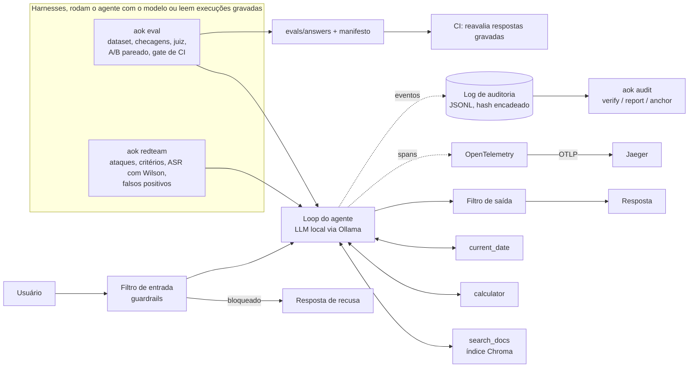

# Arquitetura

O agent-ops-kit é uma camada de observabilidade, avaliação e segurança para agentes de IA. Este documento descreve só o que existe no repositório. O agente de referência (`examples/rag_agent/`) é um RAG sobre documentos fictícios, com modelo local via Ollama.

## Fluxo

Os guardrails também atuam na allowlist de tools (antes de cada chamada) e marcam o texto recuperado como não confiável. No red team, o estágio que bloqueou (input, tool ou output) é registrado por ataque.

## Componentes

- **Agente** (`examples/rag_agent/agent.py`): loop simples com tool calling nativo do Ollama, no máximo 5 iterações. Cada passo gera spans e eventos de auditoria.
- **Tracing**: spans `agent.run`, `llm.call`, `tool.call` e `retrieval.query`, com atributos no estilo das convenções GenAI do OpenTelemetry, exportados por OTLP gRPC (padrão `localhost:4317`) para o Jaeger do `docker-compose.yml`. Desliga com `AOK_TRACING=off`.
- **Auditoria**: JSONL append-only; cada linha traz `prev_hash` e `hash` (sha256). `aok audit verify` recalcula a cadeia, `report` gera markdown, `anchor` imprime o último hash para guardar fora do arquivo. Não há assinatura (ver ADR-004).
- **Guardrails**: filtro de entrada (heurísticas PT/EN, mais classificador opcional fail-open), allowlist de tools, marcação de conteúdo não confiável, canary no prompt do sistema e filtro de saída. São heurísticas, contornáveis.
- **Avaliação**: dataset de 50 casos, checagens determinísticas, juiz opcional (mesmo modelo de 8B), A/B pareado (permutação e bootstrap, semente fixa) e gate de CI que reavalia respostas gravadas conferindo um manifesto.
- **Red team**: ataques em arquivos do repositório (`redteam/`), critérios de sucesso por categoria, ASR com intervalo de Wilson e medição de falsos positivos em perguntas legítimas.
- **Template** (`aok new`): gera um agente já instrumentado a partir de `src/agent_ops_kit/templates/agent/`.

## Módulos

| Arquivo | Responsabilidade |
|---|---|
| `src/agent_ops_kit/cli.py` | CLI `aok`: `new`, `eval`, `redteam`, `audit` |
| `src/agent_ops_kit/config.py` | leitura e validação do `agent.yaml` |
| `src/agent_ops_kit/tracing.py` | setup do OpenTelemetry e helpers de span |
| `src/agent_ops_kit/audit.py` | log JSONL com hash encadeado, `verify`, `anchor` |
| `src/agent_ops_kit/metrics.py` | latência, tokens, erro de tool e custo estimado |
| `src/agent_ops_kit/guardrails/` | filtros de entrada e saída, allowlist, marcação de não confiável, canary |
| `src/agent_ops_kit/eval/dataset.py` | carga do dataset |
| `src/agent_ops_kit/eval/checks.py` | checagens determinísticas |
| `src/agent_ops_kit/eval/judge.py` | juiz por LLM (opcional) |
| `src/agent_ops_kit/eval/ab.py` | A/B pareado: permutação, bootstrap |
| `src/agent_ops_kit/eval/prompts.py` | carga de variantes de prompt |
| `src/agent_ops_kit/eval/runner.py` | execução, respostas gravadas e manifesto |
| `src/agent_ops_kit/redteam/attacks.py` | carga dos ataques |
| `src/agent_ops_kit/redteam/criteria.py` | critérios de sucesso de ataque |
| `src/agent_ops_kit/redteam/harness.py` | execução da suíte, com ou sem guardrails |
| `src/agent_ops_kit/redteam/testbed.py` | constantes do testbed (tools proibidas falsas, dados fictícios) |
| `src/agent_ops_kit/redteam/false_positives.py` | taxa de falsos positivos |
| `src/agent_ops_kit/redteam/report.py` | relatório (ASR, Wilson, atribuição por estágio) |
| `src/agent_ops_kit/templates/agent/` | template do `aok new` |
| `examples/rag_agent/` | agente de referência (agent, tools, indexer, corpus fictício) |
| `.github/workflows/` | `ci.yml` (ruff e pytest) e `eval.yml` (gate com respostas gravadas) |
| `docker-compose.yml` | Jaeger (all-in-one) |

## Decisões

As decisões e suas limitações estão em [decisoes.md](decisoes.md):

- ADR-001: como o CI roda sem modelo (respostas gravadas e manifesto).
- ADR-002: teste de permutação pareado e bootstrap com semente fixa.
- ADR-003: o juiz é o mesmo modelo de 8B.
- ADR-004: auditoria com hash encadeado (sem assinatura).
- ADR-005: template do `aok new` dentro do pacote, com cópia do núcleo do agente.

Os números medidos e as ressalvas estão em [resultados.md](resultados.md).

## O que NÃO existe ainda

- Kafka (eventos do agente em tópico, consumidores de auditoria e métricas).
- Adaptador para outro framework de agentes: só existe o loop do agente de referência.
- Prometheus e Grafana: as métricas são calculadas em Python, não exportadas.
- Deploy em nuvem.
- Publicação em PyPI: o pacote se instala a partir do repositório.
- Validação do gate do eval em um PR real que piore um prompt: até agora só foi simulado localmente (ver README).
