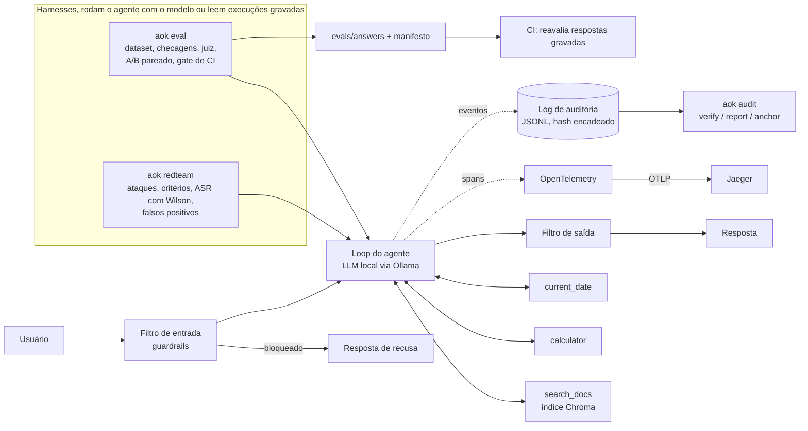
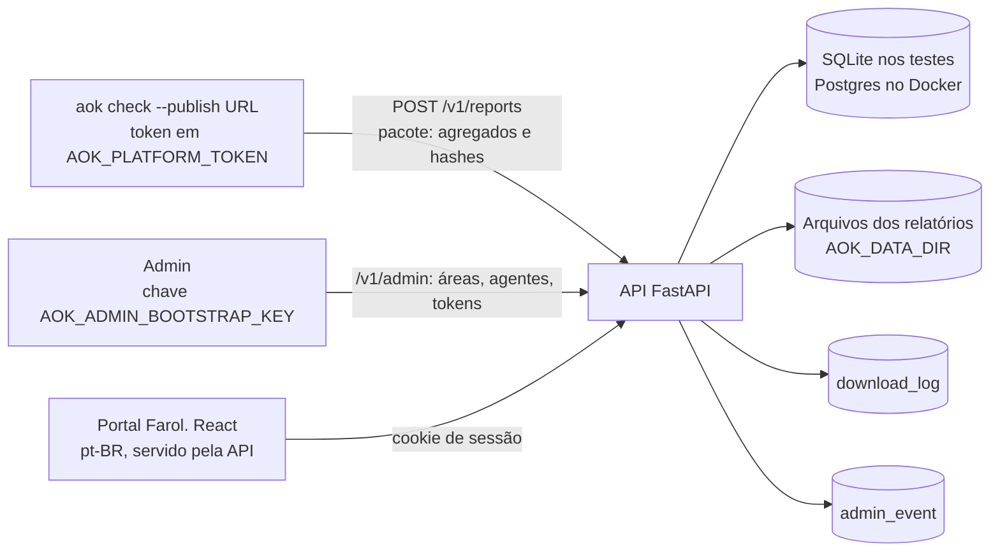
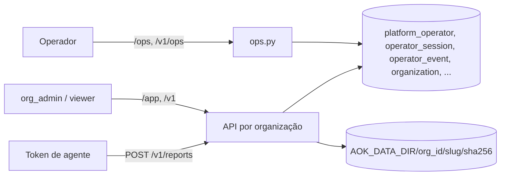

# Arquitetura

O agent-ops-kit é uma camada de observabilidade, avaliação e segurança para agentes de IA. Este documento descreve só o que existe no repositório. O agente de referência (`examples/rag_agent/`) é um RAG sobre documentos fictícios, com modelo local via Ollama.

## Fluxo

Os guardrails também atuam na allowlist de tools (antes de cada chamada) e marcam o texto recuperado como não confiável. No red team, o estágio que bloqueou (input, tool ou output) é registrado por ataque.

## Componentes

- **Agente** (`examples/rag_agent/agent.py`): loop simples com tool calling nativo do Ollama, no máximo 5 iterações. Cada passo gera spans e eventos de auditoria.
- **Tracing**: spans `agent.run`, `llm.call`, `tool.call` e `retrieval.query`, com atributos no estilo das convenções GenAI do OpenTelemetry, exportados por OTLP gRPC (padrão `localhost:4317`) para o Jaeger do `docker-compose.yml`. Desliga com `AOK_TRACING=off`.
- **Auditoria**: JSONL append-only; cada linha traz `prev_hash` e `hash` (sha256). `aok audit verify` recalcula a cadeia, `report` gera markdown, `anchor` imprime o último hash para guardar fora do arquivo. A assinatura da âncora (Ed25519 ou HMAC) é opcional (ADR-004 e ADR-018).
- **Guardrails**: filtro de entrada (heurísticas PT/EN, mais classificador opcional fail-open), allowlist de tools, marcação de conteúdo não confiável, canary no prompt do sistema e filtro de saída. São heurísticas, contornáveis.
- **Avaliação**: dataset de 50 casos, checagens determinísticas, juiz opcional (mesmo modelo de 8B), A/B pareado (permutação e bootstrap, semente fixa) e gate de CI que reavalia respostas gravadas conferindo um manifesto.
- **Red team**: ataques em arquivos do repositório (`redteam/`), critérios de sucesso por categoria, ASR com intervalo de Wilson e medição de falsos positivos em perguntas legítimas.
- **Relatório** (`aok report build`, `aok check --publish`): resultados gravados (eval e red team, mais o resultado da verificação da auditoria, se houver) viram um pacote determinístico (`relatorio.md`, `relatorio.html`, `relatorio.json` e `pacote.json`, mais `relatorio.json.sig` se houver chave de assinatura) com proveniência (ADR-022), política com limiar e valor observado por regra (ADR-023), achados rastreáveis (ADR-024), McNemar e ressalvas geradas dos dados (ADR-025) e mapa OWASP (ADR-027). `aok report verify` recalcula tudo offline (ADR-026). O pacote `--publish` copia para uma pasta local versionada (`<pasta>/<agent-id>/<timestamp UTC>/`, com `index.json` listando as versões) ou envia à plataforma (`https://...`). `relatorio.md` e `relatorio.html` seguem estrutura técnico-executiva baseada na ABNT NBR 10719:2015 e NBR 6024:2012 (identificação documental, resumo executivo, leitura de negócios, encaminhamentos, quadro de ciência para auditoria e Apêndice A com evidências técnicas e SHA-256), com CSS estático A4 (`3cm 2cm 2cm 3cm`) pronto para impressão ou salvamento em PDF pelo navegador. Não roda modelo e o log de auditoria não entra no pacote (ADR-006 e ADR-013).
- **Plataforma** (`platform/`): serviço FastAPI que recebe o pacote por `POST /v1/reports` e, para pessoas com sessão, serve a leitura e o portal **Farol.** em `pt-BR`. Entregue em fases: API (ADR-007), portal (ADR-008), administração (ADR-009), operador e várias organizações (ADR-010 e ADR-011), recuperação de senha opcional (ADR-012), prontidão para operação online em instância única (ADR-014) e consolidação do portal **Farol.** em `pt-BR` (ADR-015); ver abaixo.
- **Template** (`aok new`): gera um agente já instrumentado a partir de `src/agent_ops_kit/templates/agent/`.

## Plataforma (`platform/`)

O admin cria área e agente e emite o token do agente (guardado como hash). O agente publica com `platform.agent_id` do `agent.yaml` (ou `--agent-id`), que deve ser o slug dono do token. A API valida o esquema fechado, o limite de 1 MiB e o sha256 de cada arquivo, e grava uma versão com `seq` por agente. O log de auditoria não sobe.

Fase 3 (ADR-008), fluxos:

- **Login**: `POST /v1/auth/login` (e-mail e senha, scrypt) cria uma sessão e devolve o cookie `aok_session` (HttpOnly, SameSite=Strict). O throttle por e-mail é em memória.
- **Leitura**: o portal chama `/v1/areas`, `/v1/areas/{id}/agents`, `/v1/agents/{id}/reports` e `/v1/reports/{id}`. O alcance vem da `membership`: `area_viewer` vê a área e as sub-áreas (CTE recursiva), `org_admin` vê tudo, o resto responde 404. O token de agente não lê.
- **Telas do portal** (**Farol.**, interface 100% em `pt-BR` centralizada em `platform/portal/src/copy.ts`, direção visual de diário de bordo com tipografia autohospedada via `@fontsource`, foco B2B sem cadastro aberto nem preços e `CONTACT_URL` opcional em `brand.ts`; ADR-015): `/` (landing), `/login`, `/app` e `/app/areas/:areaId` (áreas), `/app/areas/:areaId/agents/:agentId` (relatórios do agente), `/app/reports/:reportId` (detalhe, semáforo com glifos `●` Verde, `◐` Amarelo e `✕` Vermelho + regras provisórias e ressalvas visíveis, e botões `Baixar HTML (ABNT / PDF)`, `Baixar Markdown` e `Baixar JSON`), `/app/downloads` ("Meus downloads") e, só `org_admin`, `/app/admin/downloads` ("Todos os downloads").
- **Administração** (ADR-009, só `org_admin`): telas `/app/admin/areas`, `agents`, `agents/:id` (tokens), `users` e `activity`. Rotas novas: `GET /v1/admin/areas`, `/agents`, `/agents/{id}/tokens`, `/users`, `/memberships` e `/events`. Leituras e escritas ficam na organização de quem chama (alvo de outra organização: 404). Bloqueios 409: não desativar a própria conta nem revogar o próprio `org_admin`; nunca o último `org_admin` ativo (vale também para a chave de bootstrap, que usa a primeira organização).
- **Trilha `admin_event`**: toda escrita administrativa grava quando, quem, ação e alvo, sem segredos, na mesma transação. Imutável pela API (e pelo ORM); quem opera o banco pode alterar. `GET /v1/admin/events` só aceita sessão de `org_admin`, com `limit` e `offset`. As demais listagens do admin não têm paginação.
- **Download com log**: `GET /v1/reports/{id}/download?format=md|html|json` confere o alcance, grava uma linha em `download_log` (baixado em, relatório gerado em) e devolve o arquivo. `/v1/me/downloads` mostra os do próprio usuário; `/v1/admin/downloads` (`org_admin` por sessão) mostra todos.

### Multi-organização e operador (ADR-010 e ADR-011)

- Tabelas novas: `platform_operator`, `operator_session`, `operator_event` (imutável pela API e pelo ORM). O operador não pertence a nenhuma organização.
- Rotas `/v1/ops/*`: só existem com `AOK_OPS_ENABLED=true`; sessão e cookie próprios. Nenhuma devolve conteúdo de relatório, ressalvas, arquivos, hashes de relatório, tokens ou download.
- Armazenamento de relatórios novos: `AOK_DATA_DIR/<org_id>/<slug>/<sha256>`.
- Chave de bootstrap: 1 organização, como antes; 2 ou mais exigem `X-Org-Slug`.

### Fluxo e implantação online (ADR-014)

Em produção (instância única), o pipeline de CI do agente executa `aok check --publish https://...` enviando apenas o pacote (`relatorio.json`, `relatorio.md`, `relatorio.html` e `pacote.json`) por HTTPS para a API. A plataforma roda em container único (API FastAPI + portal React compilado) atrás de proxy reverso HTTPS, conectada a um Postgres externo/gerenciado e com disco persistente em `AOK_DATA_DIR`:

- `GET /v1/health` verifica o banco (`SELECT 1`) e o acesso a `AOK_DATA_DIR` (`200` ou `503`, `Cache-Control: no-store`).
- `AOK_DOCS_ENABLED=false` desliga `/docs`, `/redoc` e `/openapi.json` (inclusive no fallback da SPA).
- O middleware HTTP adiciona `X-Content-Type-Options: nosniff`, `X-Frame-Options: DENY` e `Referrer-Policy: no-referrer`, além de `Strict-Transport-Security` com `AOK_HSTS_ENABLED=true`.
- `AOK_TRUSTED_PROXIES` define os IPs/CIDRs de proxies confiáveis para extrair o IP do cliente (varredura direita-esquerda em `X-Forwarded-For`) na recuperação de senha.

Configuração completa e limites (instância única; múltiplas réplicas ainda exigem Alembic e store compartilhado para os limitadores em memória): ver [platform/README.md](../platform/README.md) e o ADR-014 em [decisoes.md](decisoes.md).

## Módulos

| Arquivo | Responsabilidade |
|---|---|
| `src/agent_ops_kit/cli.py` | CLI `aok`: `new`, `eval`, `redteam`, `audit`, `report`, `check` |
| `src/agent_ops_kit/config.py` | leitura e validação do `agent.yaml` |
| `src/agent_ops_kit/tracing.py` | setup do OpenTelemetry e helpers de span |
| `src/agent_ops_kit/audit.py` | log JSONL com hash encadeado, `verify`, `anchor` |
| `src/agent_ops_kit/metrics.py` | latência, tokens, erro de tool e custo estimado |
| `src/agent_ops_kit/guardrails/` | filtros de entrada e saída, allowlist, marcação de não confiável, canary |
| `src/agent_ops_kit/eval/dataset.py` | carga do dataset |
| `src/agent_ops_kit/eval/checks.py` | checagens determinísticas |
| `src/agent_ops_kit/eval/judge.py` | juiz por LLM (opcional) |
| `src/agent_ops_kit/eval/ab.py` | A/B pareado: permutação, bootstrap |
| `src/agent_ops_kit/eval/prompts.py` | carga de variantes de prompt |
| `src/agent_ops_kit/eval/runner.py` | execução, respostas gravadas e manifesto |
| `src/agent_ops_kit/redteam/attacks.py` | carga dos ataques |
| `src/agent_ops_kit/redteam/criteria.py` | critérios de sucesso de ataque |
| `src/agent_ops_kit/redteam/harness.py` | execução da suíte, com ou sem guardrails |
| `src/agent_ops_kit/redteam/testbed.py` | constantes do testbed (tools proibidas falsas, dados fictícios) |
| `src/agent_ops_kit/redteam/false_positives.py` | taxa de falsos positivos |
| `src/agent_ops_kit/redteam/report.py` | relatório (ASR, Wilson, atribuição por estágio) |
| `src/agent_ops_kit/report/` | pacote de relatório: `build` (agrega resultados gravados), `render` (md/html determinístico em estrutura ABNT NBR 10719 pronta para impressão A4/PDF), `publish` (pasta local versionada ou envio à plataforma) |
| `src/agent_ops_kit/report/policy.py` | política de classificação (semáforo) lida de YAML, com limiar, valor observado e resultado por regra (ADR-023) |
| `src/agent_ops_kit/report/findings.py` | `findings[]` rastreáveis até arquivo, linha e sha256 do registro; tabela de severidade provisória (ADR-024) |
| `src/agent_ops_kit/report/stats.py` | McNemar exato, efeito mínimo detectável e ressalvas geradas dos dados (ADR-025) |
| `src/agent_ops_kit/report/coverage.py` | mapa de cobertura OWASP LLM Top 10 no relatório (ADR-027) |
| `src/agent_ops_kit/report/verify.py` | `aok report verify`: recalcula números, semáforo e hashes do pacote, offline (ADR-026) |
| `src/agent_ops_kit/provenance.py` | proveniência: versão, commit, ambiente, Ollama, sementes e sha256 das entradas (ADR-022) |
| `src/agent_ops_kit/target.py` | adaptador de agente Python (`target` no `agent.yaml`): contrato, validação da saída e `resolve_target` (ADR-028) |
| `src/agent_ops_kit/ollama_chat.py` | chamada ao Ollama com limite de geração e timeout (ADR-028, correções de validação) |
| `src/agent_ops_kit/audit_sign.py` | assinatura Ed25519 ou HMAC da âncora de auditoria; `sign_bytes` e `verify_bytes` assinam e conferem bytes, usados no `relatorio.json` (ADR-018 e ADR-029) |
| `policies/default.yaml` | política padrão (regras "provisoria-1"), versionada fora do pacote Python |
| `policies/coverage/owasp_llm_2025.yaml` | mapa OWASP LLM Top 10 (2025): categorias de ataque e controles por risco, e riscos não cobertos com o motivo |
| `src/agent_ops_kit/templates/agent/` | template do `aok new` |
| `examples/rag_agent/` | agente de referência (agent, tools, indexer, corpus fictício) |
| `.github/workflows/` | `ci.yml` (jobs `test`: ruff check e pytest; `portal`: build do front-end; `postgres`: suíte de plataforma em Postgres 16) e `eval.yml` (gate com respostas gravadas) |
| `scripts/demo.sh` | demo do kit com respostas gravadas e log de auditoria fictício, sem modelo |
| `scripts/demo_plataforma.py` | sobe a plataforma de demonstração com um comando (SQLite, só em 127.0.0.1; seed, operador e organização `beta`; `--publicar`, `--reset`, `--dados`) |
| `docker-compose.yml` | Jaeger (all-in-one) |
| `platform/aok_platform/` | API da plataforma: `app` (inclui `/v1/health`, `AOK_DOCS_ENABLED` e headers HTTP), `auth` (senha, token, papéis), `sessions` (login, sessão, throttle), `portal` (leitura, download, histórico), `models` (inclui `admin_event`), `reports`, `db`, `seed_demo` |
| `platform/aok_platform/models.py` (`agent_public_keys`), `migrations/versions/0003_report_signature.py` | chaves públicas por agente (fingerprint, PEM, `revoked_at`) e colunas de assinatura do relatório; migração 0003 (ADR-029) |
| `platform/aok_platform/reports.py` (`_check_signature`) | no `POST /v1/reports`, confere o campo opcional `signature` contra a chave ativa do agente com `verify_bytes` (ADR-029) |
| `platform/aok_platform/app.py` (`/v1/admin/agents/{id}/keys`) | endpoints admin de chaves: listar, cadastrar e revogar (sem tela no portal) |
| `platform/portal/src/pages/ReportView.tsx` | selo "Assinado" / "Não assinado" no detalhe do relatório |
| `platform/aok_platform/ops.py` | rotas `/v1/ops/*` do operador (ADR-010): organizações com contagens, criar e desativar, criar admin e reset de senha, visão geral só de metadados, trilhas |
| `platform/aok_platform/recovery.py`, `mailer.py` | recuperação de senha (ADR-012) e `client_ip` com `AOK_TRUSTED_PROXIES`: rotas `/v1/auth/password/forgot`, `/reset` e `/v1/auth/capabilities`; token com hash SHA-256 na tabela `password_reset`; envio SMTP por stdlib. Só ativos com `AOK_SMTP_HOST` e `AOK_PUBLIC_URL` |
| `platform/portal/src/pages/ForgotPassword.tsx`, `ResetPassword.tsx` | telas `/forgot-password` e `/reset-password` (token lido do fragmento e removido da URL) |
| `platform/aok_platform/create_org.py` | `python -m aok_platform.create_org`: cria organização (slug, nome) |
| `platform/aok_platform/create_operator.py` | `python -m aok_platform.create_operator`: cria operador com senha aleatória impressa uma vez; `--reset-password`, `--activate` |
| `platform/aok_platform/db.py` (`ensure_schema`) | no startup, adiciona colunas e tabelas novas e preenche valores, de forma idempotente (não é Alembic) |
| `platform/portal/src/pages/ops/` | console do operador em `/ops/*` (sem link no site; 404 comum com `AOK_OPS_ENABLED` desligado) |
| `platform/portal/` | front-end **Farol.** em `pt-BR` (`brand.ts`, `copy.ts`, tipografia autohospedada `@fontsource`), React, Vite, TypeScript e Tailwind, servido pela API |
| `platform/docker-compose.yml` | API e Postgres. Estado das verificações (com datas e o que não foi reconfirmado): ADR-007 em [decisoes.md](decisoes.md) |

## Decisões

As decisões e suas limitações estão em [decisoes.md](decisoes.md):

- ADR-001: como o CI roda sem modelo (respostas gravadas e manifesto).
- ADR-002: teste de permutação pareado e bootstrap com semente fixa.
- ADR-003: o juiz é o mesmo modelo de 8B.
- ADR-004: auditoria com hash encadeado; a assinatura opcional da âncora veio depois (ADR-018).
- ADR-005: template do `aok new` dentro do pacote, com cópia do núcleo do agente.
- ADR-006: relatório publicado em pasta local versionada, só agregados e hashes.
- ADR-007: plataforma em `platform/`, relatório autodeclarado, só agregados e hashes.
- ADR-008: portal e login (scrypt, cookie de sessão, CSRF só por SameSite, acesso por área, `download_log`).
- ADR-009: administração do portal e trilha `admin_event`.
- ADR-010: operador da plataforma (só metadados, desligado por padrão).
- ADR-011: isolamento multi-organização.
- ADR-012: recuperação de senha por e-mail (opcional, token de uso único com hash, limites em memória).
- ADR-013: relatório técnico-executivo em linguagem de negócios e estrutura ABNT NBR 10719 (determinístico, CSS A4 para impressão/PDF pelo navegador).
- ADR-014: prontidão para operação online em instância única (`GET /v1/health`, `AOK_DOCS_ENABLED`, `AOK_HSTS_ENABLED`, `AOK_TRUSTED_PROXIES`) e simplicidade de manutenção (D1, D2, D3, D5).
- ADR-015: portal oficial **Farol.** em `pt-BR` (`copy.ts`), foco B2B sem cadastro/preços (`CONTACT_URL`), direção visual Diário de Bordo / Carta Náutica com tipografia autohospedada (`@fontsource`) e semáforo com glifos distintos além da cor.
- ADR-016 a ADR-021: Alembic, limitadores no banco, assinatura da âncora de auditoria, variância multi-execução, anti-ofuscação e suíte OWASP com suíte cega externa.
- ADR-022 a ADR-030: proveniência, política, achados, McNemar, `report verify`, cobertura OWASP, adaptador de agente, assinatura do relatório e evidências fora do repositório.

Inventário completo do que está implementado, com comandos, rotas e testes: [funcionalidades.md](funcionalidades.md).

Os números medidos e as ressalvas estão em [resultados.md](resultados.md).

## O que NÃO existe ainda

- Kafka (eventos do agente em tópico, consumidores de auditoria e métricas).
- Adaptador de framework de agentes. Existe o adaptador de agente Python (`target` no `agent.yaml`, ADR-028), que chama uma função sua; o adaptador HTTP é recusado na validação e não existe.
- `aok reproduce` (reexecução registrada no log assinado), mapeamento NIST AI RMF e ISO/IEC 42001 e tela de chaves no portal (as chaves só se gerenciam pela API admin).
- Prometheus e Grafana: as métricas são calculadas em Python, não exportadas.
- Na plataforma: SSO, cadastro aberto (Sign Up), recuperação por e-mail para operadores (a recuperação de senha por e-mail dos usuários das organizações existe, opcional: ADR-012), dark mode e geração direta de binário PDF no servidor (o HTML já sai no formato A4 ABNT NBR 10719 para impressão/PDF pelo navegador). Migrações com Alembic (ADR-016), limitadores no banco (ADR-017) e paginação `limit`/`offset` das listagens do admin (só a tela de Atividade a usa no portal) existem. Trilha de login e de leitura também não existe (só download e escritas administrativas).
- Provisionamento automatizado de deploy em nuvem (existe container/compose pronto para operação online em instância única atrás de proxy reverso HTTPS, sem scripts de infraestrutura gerenciada).
- Publicação em PyPI: o pacote se instala a partir do repositório.
- Validação do gate como medida de qualidade: ele foi exercitado em 2 PRs de teste (ver a seção D de [resultados.md](resultados.md)), que provam o mecanismo, não a qualidade.
- Relatório verificado pela plataforma quanto à execução: o relatório continua autodeclarado e a plataforma não reexecuta eval nem red team (ADR-007). Hoje existe a verificação offline `aok report verify` (ADR-026) e a plataforma confere a assinatura Ed25519 do `relatorio.json` contra a chave cadastrada do agente (ADR-029); ela não roda o `verify` completo sobre as evidências.
